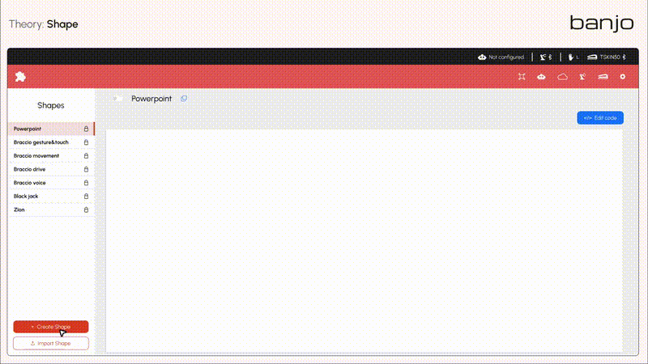
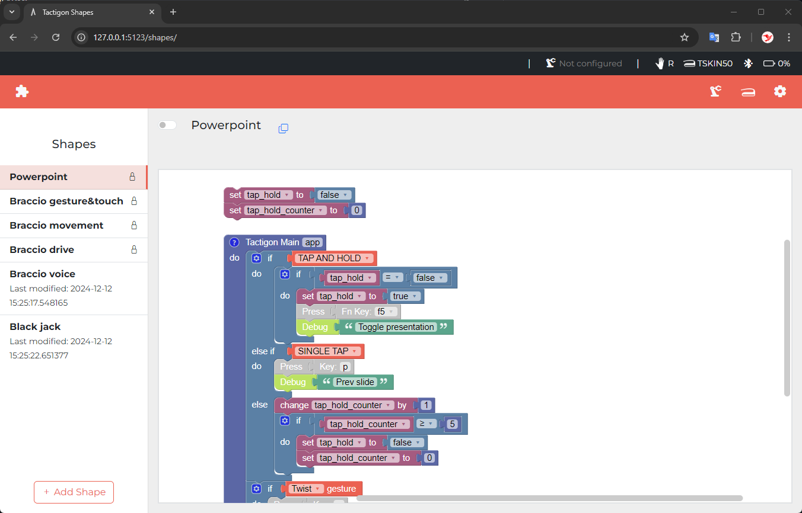
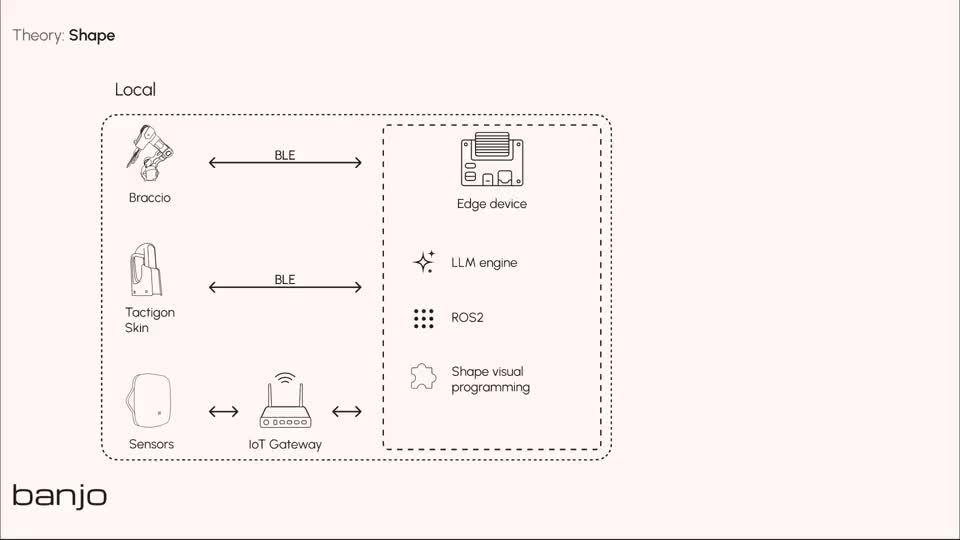

<p align="center">
  
</p>

# SHAPE — Visual programming for robotics and IoT

**Connect ROS 2, MQTT, REST APIs and local AI in visual workflows.**

Build application logic with Blockly-based blocks: receive data, apply conditions and trigger actions. Run SHAPE locally with Docker, connect your devices and services, and extend the environment with custom blocks and Python modules.

For robotics developers, IoT makers and educators building connected applications.

**[Get started](#quick-start)** · **[Explore projects](#projects-you-can-build)** · **[Documentation](https://thetactigon.com/docs/)** · **[Report an issue](https://github.com/TactigonTeam/Tactigon-Shape/issues)**

[](https://thetactigon.com/wp-content/uploads/2026/10/SHAPE_Visual_Development_Preview.mp4)

*Watch the 29-second visual development preview. Click the animation to open the video.*

## What you can build

| Connect | Build with SHAPE | Start here |
| --- | --- | --- |
| MQTT | Receive device messages, inspect payloads and publish data | [Your first MQTT message](https://thetactigon.com/docs/receive-mqtt-message-shape/) |
| ROS 2 | Publish and subscribe to topics; connect robot and camera nodes | [ROS 2 getting started](https://thetactigon.com/docs/ros-2-shape-getting-started/) |
| Ollama | Send prompts to a local language model and display its response | [Local AI walkthrough](https://thetactigon.com/docs/use-ollama-with-tactigon-shape/) |
| REST APIs and ZION | Exchange application data with services and IoT dashboards | [Robot status dashboard](https://thetactigon.com/iot-dashboard-shape-zion/) |
| CHORDS | Upload documents, prepare RAG and request document-based responses | [CHORDS walkthrough](https://thetactigon.com/docs/chords-tactigon-shape/) |
| Tactigon GEAR / SKIN | Add voice and gesture interaction; use SKIN for wearable input | [Gesture-controlled robotics](https://thetactigon.com/arduino-braccio-gesture-control/) |

**You can start without a robot or wearable.** The first MQTT tutorial uses a browser client and sample data. Physical devices are needed for the corresponding hardware projects; CHORDS requires access to a configured service.

## Quick start

### Choose your environment

| Environment | Setup path |
| --- | --- |
| Ubuntu PC | The installation guide specifies Ubuntu 24.04, an AVX/FMA-capable CPU, 8 GB RAM and 32 GB disk space |
| Windows through WSL | Follow the [WSL prerequisites](https://github.com/TactigonTeam/Tactigon-Shape/wiki/Prerequisites-and-installing#windows-subsystem-for-linux-wsl) before starting |
| NVIDIA Jetson Orin NX | Follow the [Jetson guide](https://thetactigon.com/docs/install-shape-on-nvidia-jetson-orin-nx/), documented for a Seeed reComputer J4012, Orin NX 16 GB and JetPack 6.0 |

The Ubuntu PC CPU requirement does not apply to the separate ARM-based Jetson setup. Model memory and storage requirements depend on the Ollama model you choose. SKIN requires compatible Bluetooth Low Energy hardware.

### Start on a prepared Linux desktop

You need Git, a running Docker Engine accessible to your user without `sudo`, Docker Compose and `xhost` in your graphical session. Check them first:


- `git --version` (verifies Git is installed)
- `docker info` (verifies Docker is running and you have correct user permissions without sudo)
- `docker compose version` (verifies the Compose plugin is available)
- `xhost` (verifies the X server access control tool is installed)


Then download and start SHAPE:

```bash
git clone https://github.com/TactigonTeam/Tactigon-Shape.git
cd Tactigon-Shape
bash start.sh
```

The current `start.sh` configures local Docker display access with `xhost` and runs `docker compose up --build`. Keep the terminal open while the stack starts; the first run needs internet access to download images and dependencies.

Open **[http://localhost:5123](http://localhost:5123)** in your browser.



For system preparation, see [Install SHAPE with Docker](https://thetactigon.com/docs/install-shape-docker/). Use the dedicated instructions above for WSL and Jetson.

## Your first workflow

Start with **[Create your first Shape](https://thetactigon.com/docs/create-your-first-shape/)** to learn how to create a project, connect blocks, save it and run it.

Then receive an MQTT message without a physical sensor:

1. Follow [Receive your first MQTT message](https://thetactigon.com/docs/receive-mqtt-message-shape/) to connect MQTTX Web and SHAPE to the example broker.
2. In SHAPE, configure the reception block for `shape/input` and connect the received payload to `Debug`.
3. Save and run the Shape.
4. In MQTTX Web, publish this sample JSON on the same topic:

```json
{
  "Temperatura": 40
}
```

**Expected result:** SHAPE's Debug output shows the received payload, including `Temperatura` and `40`. The value is demonstration data, entered manually.

The guide uses a shared public broker: send sample data only. A distinctive topic can reduce interference; use exactly the same topic in both applications.

**Next:** [Publish a message from SHAPE](https://thetactigon.com/docs/send-mqtt-messages-shape/) or explore the [MQTT block reference](https://thetactigon.com/docs/mqtt-blocks-shape/).

## Projects you can build

### Camera-guided pick and place

Point at an ArUco marker to select a predefined action. A camera node publishes the selection through ROS 2; SHAPE coordinates the Arduino Braccio's pickup and placement logic.

[](https://thetactigon.com/wp-content/uploads/2026/10/ROS2_Camera_Braccio.mp4)

**Requires:** configured Arduino Braccio, camera and markers. The marker selects a predefined position; it does not calculate robot coordinates.

[Project guide](https://thetactigon.com/control-an-arduino-braccio-with-ros-2-camera-tracking/) · [Technical walkthrough](https://thetactigon.com/docs/ros-2-camera-tracking-robotic-arm/)

### Local AI with Ollama

Configure an available model, connect an `AI prompt` block to `Debug`, and inspect the generated response. The documented example uses Mistral. Stop the workflow after checking the response if your prompt is inside a repeating loop.

[Follow the Ollama guide](https://thetactigon.com/docs/use-ollama-with-tactigon-shape/)

### Document-based sensor troubleshooting

Combine MQTT events with CHORDS document retrieval: receive a sensor error code, query the supplied manual and publish a structured response to another MQTT topic.

**Requires:** a configured CHORDS/ChordLLM service and source documents. Check generated responses against the manual.

[Build the diagnostic example](https://thetactigon.com/docs/llm-based-error-diagnosis-using-shape/)

### Robot application status on an IoT dashboard

Send a movement status value from SHAPE to a ZION device and display it on a dashboard. This represents the status reported by the application; it is not independent measurement of physical movement.

[Follow the dashboard guide](https://thetactigon.com/iot-dashboard-shape-zion/)

## How the ecosystem fits together

[](https://thetactigon.com/wp-content/uploads/2026/10/ecosystem-cartoon.mp4)

[Watch the 42-second ecosystem animation](https://thetactigon.com/wp-content/uploads/2026/10/ecosystem-cartoon.mp4)

- **SHAPE** defines visual application logic.
- **ROS 2, MQTT and REST APIs** connect that logic to configured devices, nodes and services.
- **Ollama** runs the language model used by local AI workflows.
- **CHORDS** provides a separately configured AI service for workflows such as document retrieval.
- **GEAR** provides voice and gesture capabilities; **SKIN** is optional wearable input.

Device compatibility depends on drivers, interfaces and message types. See the [product overview](https://thetactigon.com/shape/) for deployment options and services.

## Extend SHAPE

Create custom blocks and modules around your own devices and application behaviour. Start with the [custom block and module guides](https://github.com/TactigonTeam/Tactigon-Shape/wiki/Contribute-by-Creating-Your-Own-Blocks).

Useful references:

- [ROS 2 blocks](https://thetactigon.com/docs/ros-2-blocks-tactigon-shape/)
- [Source documentation and exercises](https://github.com/TactigonTeam/Tactigon-Shape/wiki)
- [Tactigon GEAR package](https://pypi.org/project/tactigon-gear/)
- [Tactigon Speech package](https://pypi.org/project/tactigon-speech/)

## Troubleshooting and contributions

If the interface does not open, inspect service status and startup logs from the repository directory:

```bash
docker compose ps
docker compose logs --tail=100
```

[Open an issue](https://github.com/TactigonTeam/Tactigon-Shape/issues) with your operating system, hardware, setup steps, expected behaviour and relevant error output. Remove credentials before sharing logs.

Contributions are welcome: improve a tutorial, report an installation problem, add an example or propose a custom block. For larger changes, open an issue to discuss the approach first.

**Built something with SHAPE?** Share your setup and result in an issue. If the project is useful to you, give it a star and share a tutorial with someone building robotics or IoT applications.

[Website](https://thetactigon.com/) · [Documentation](https://thetactigon.com/docs/) · [Project guides](https://thetactigon.com/category/guides/) · [Contact](https://thetactigon.com/contact/)

## License

SHAPE is distributed under the [Apache License 2.0](LICENSE) and is built on [Google Blockly](https://developers.google.com/blockly). Connected services, models and hardware have their own requirements and terms.
